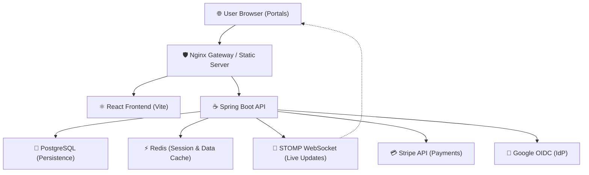
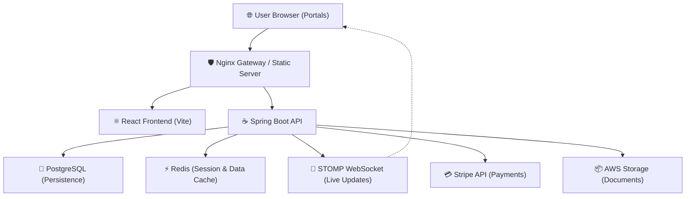
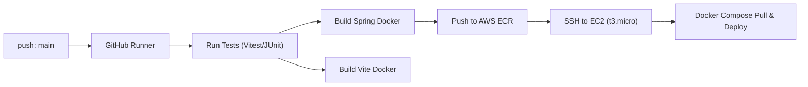

# 📚 Bookfair Stall Reservation System

A high-performance, real-time ecosystem designed to manage the end-to-end lifecycle of large-scale event stall allocations. This platform transforms a manual reservation process into an automated, data-driven **Revenue Optimization** tool for event organizers.

> **Assessment 2 — Secure Web Application Development**
> This system implements OIDC authentication (Google IdP), RBAC for Vendor and Organizer roles, and comprehensive OWASP Top 10 mitigations.

---

## 🚀 Quick Start — Local Deployment

### Prerequisites
| Tool | Minimum Version |
|---|---|
| Java JDK | 21 |
| Node.js | 18 |
| Docker & Docker Compose | 24.x |
| PostgreSQL | 16 (or use Docker) |
| Redis | 7 (or use Docker) |

---

### Step 1 — Clone the Repository
```bash
git clone https://github.com/StereoSachiiii/reservation_system.git
cd reservation-system
```

---

### Step 2 — Configure Environment Variables

> ⚠️ **IMPORTANT**: All sensitive credentials have been removed from the source code and must be configured locally. Never commit `.env` to version control.

Copy the example environment file and fill in your values:
```bash
cp .env.example .env
```

Edit `.env` with your local values:
```env
# Database
DB_URL=jdbc:postgresql://localhost:5432/reservation_db
DB_USERNAME=postgres
DB_PASSWORD=your_secure_password_here

# JWT — generate a 256-bit (64 hex character) secret, e.g.:
# python3 -c "import secrets; print(secrets.token_hex(32))"
JWT_SECRET=your_64_character_hex_secret_here

# Google OIDC — create credentials at https://console.cloud.google.com/apis/credentials
# Authorized JavaScript origins: http://localhost:5173
# Authorized redirect URIs: http://localhost:5173
GOOGLE_CLIENT_ID=your_google_oauth2_client_id.apps.googleusercontent.com

# Stripe (for payment processing — use test keys)
STRIPE_SECRET_KEY=sk_test_your_stripe_test_secret_key
STRIPE_WEBHOOK_SECRET=whsec_your_stripe_webhook_secret

# Frontend URL (for CORS and password reset email links)
FRONTEND_URL=http://localhost:5173

# Email (for password reset notifications)
MAIL_HOST=smtp.gmail.com
MAIL_PORT=587
MAIL_USERNAME=your_email@gmail.com
MAIL_PASSWORD=your_app_password
```

---

### Step 3 — Set Up the Database

Run the schema creation and seed script:
```bash
# Option A: Using psql directly
psql -U postgres -c "CREATE DATABASE reservation_db;"
psql -U postgres -d reservation_db -f schema.sql

# Option B: The Docker Compose setup initializes the DB automatically (see Step 5)
```

---

### Step 4 — Generate SSL Certificates (for HTTPS)
```bash
# Self-signed certs for local development
chmod +x generate-ssl.sh
./generate-ssl.sh

# For production: renew Let's Encrypt certificates
chmod +x renew-certs.sh
./renew-certs.sh
```

---

### Step 5 — Run with Docker Compose (Recommended)

This starts all services together: Spring Boot API, React Frontend, PostgreSQL, Redis, and Nginx.
```bash
docker-compose up -d

# View logs
docker-compose logs -f

# Stop all services
docker-compose down
```

**Service URLs (Docker):**
| Service | URL |
|---|---|
| Frontend | http://localhost |
| Backend API | http://localhost:8080 |
| PostgreSQL | localhost:5432 |
| Redis | localhost:6379 |

---

### Step 6 — Run Manually (Development Mode)

**Backend:**
```bash
cd backend
./mvnw spring-boot:run
# API available at http://localhost:8080
```

**Frontend:**
```bash
cd frontend
npm install
npm run dev
# App available at http://localhost:5173
```

---

### Step 7 — Default Login Credentials

| Role | Login Method | Notes |
|---|---|---|
| Stall Vendor | Google OIDC (via "Sign in with Google") | Creates account on first login |
| Exhibition Organizer | Username + Password on `/admin/login` | See seed data in `schema.sql` |
| Employee | Username + Password on `/employee/login` | See seed data in `schema.sql` |

Default admin credentials are defined in `schema.sql` (seed section). **Change these before any public deployment.**

---

## 🏗️ System Architecture

The platform uses a decoupled, containerized architecture optimized for cloud-native deployment.



### 🛰️ Real-Time Logic
All map interactions (reservations, cancels, admin locks) are reflected **sub-100ms** across all connected clients via a dedicated **STOMP Broker**. This eliminates the need for polling and prevents double-booking disputes.

---

## 🏛️ Domain Architecture

The platform follows a hierarchical approach to spatial management:

| Entity | Role | Key Attribute |
| :--- | :--- | :--- |
| **Venue** | Global physical location | Address, timezone |
| **Hall** | Specific room/area | Floor plan, height, utilities |
| **Stall Template** | Blueprint for a physical spot | Base Rate, Size (S/M/L) |
| **Event Stall** | A "Live" instance of a template | **Final Price (Calculated)**, Multiplier |
| **Reservation** | Legal & Financial binding | Status (PAID/PENDING), QR Code |

---

## 🔐 Security Overview (OWASP Top 10)

| OWASP Category | Mitigation |
|---|---|
| A01 – Broken Access Control | IDOR checks in service layer; `@PreAuthorize` guards |
| A02 – Cryptographic Failures | BCrypt + HTTPS/TLS + HMAC-SHA256 JWTs |
| A03 – Injection | JPA parameterized queries; Bean Validation; React JSX auto-escaping |
| A04 – Insecure Design | Pessimistic DB locks on concurrent bookings |
| A05 – Security Misconfiguration | Global exception handler; externalized config; CORS allowlist |
| A06 – Vulnerable Components | Spring Boot managed BOM; periodic CVE audit |
| A07 – Auth Failures | Bucket4j rate limiting (100 req/min/IP) |
| A08 – Data Integrity Failures | JWT signature verification; no raw Java deserialization |
| A09 – Logging Failures | SLF4J structured auth logging; Actuator metrics |
| A10 – SSRF | No user-controlled URL fetching; SDK-only outbound calls |

---

## 🛳️ Deployment & CI/CD

The system is deployed on **AWS** using a cost-efficient `t3.micro` footprint with a GitHub Actions CI/CD pipeline that builds Docker images, pushes to ECR, and deploys via SSH on every push to `main`.

---

## 📁 Project Structure

```text
reservation_system/
├── .env.example                # Environment variable template (commit this)
├── .env                        # Your local secrets (NEVER commit)
├── schema.sql                  # Database creation + seed script
├── docker-compose.yml          # Full stack orchestration
├── generate-ssl.sh             # Self-signed cert generator
├── backend/                    # Java 21 Spring Boot API
│   ├── src/main/java/com/bookfair/
│   │   ├── config/             # Redis, Security, WebSocket config
│   │   ├── controller/         # REST endpoints (Admin, Auth, Public)
│   │   ├── features/reservation/ # Reservation feature module
│   │   ├── security/           # JWT filter, OIDC verifier, SecurityConfig
│   │   └── service/            # Business logic, pricing engine
│   └── src/main/resources/
│       └── application.properties  # Configurable parameters
├── frontend/                   # React 18 / TypeScript 5
│   ├── src/apps/               # Role-specific portals (Admin, Vendor, Employee)
│   ├── src/shared/api/         # TanStack Query API wrappers
│   └── src/shared/components/  # Reusable UI (ProtectedRoute, Layout)
└── certs/                      # SSL certificates (gitignored)
```

---

## 🧩 Advanced Features
- **TanStack Query**: All async data fetching with automatic cache invalidation on mutations.
- **Atomic Locking**: PostgreSQL `SELECT FOR UPDATE` for concurrent booking safety.
- **Dynamic Pricing**: Heuristic engine considering stall geometry, proximity, and hall tier.
- **Real-time Canvas**: STOMP WebSocket pushes stall status changes to all connected clients instantly.
- **QR Entry Passes**: Auto-generated on payment confirmation, scannable at venue entry.


---

## 🏗️ System Architecture

The platform uses a decoupled, containerized architecture optimized for cloud-native deployment.



### 🛰️ Real-Time Logic
All map interactions (reservations, cancels, admin locks) are reflected **sub-100ms** across all connected clients via a dedicated **STOMP Broker**. This eliminates the need for polling and prevents double-booking disputes.

---

## 🏛️ Domain Architecture

The platform follows a hierarchical approach to spatial management:

| Entity | Role | Key Attribute |
| :--- | :--- | :--- |
| **Venue** | Global physical location | Address, timezone |
| **Hall** | Specific room/area | Floor plan, height, utilities |
| **Stall Template** | Blueprint for a physical spot | Base Rate, Size (S/M/L) |
| **Event Stall** | A "Live" instance of a template | **Final Price (Calculated)**, Multiplier |
| **Reservation** | Legal & Financial binding | Status (PAID/PENDING), QR Code |

---

## 🛳️ Deployment & CI/CD (The Production Roadmap)

The system is deployed on **AWS** using a highly cost-efficient `t3.micro` footprint.

### CI/CD Pipeline (GitHub Actions)


### Infrastructure Specs
- **Compute**: AWS EC2 `t3.micro` (2 vCPU, 1 GiB RAM).
- **Network**: DuckDNS/Route53 for dynamic IP resolution + Nginx for SSL termination.
- **Monitoring**: Spring Boot Actuator + `SystemHealth.tsx` dashboard for real-time uptime checks.

---

## 📁 Project Structure walkthrough

```text
reservation_system/
├── .github/workflows/          # Automated deployment workflows
├── backend/                    # Java 21 Performance API
│   ├── config/                 # Redis, Security, WebSocket, and Thread-pool config
│   ├── controller/             # Resource-oriented REST Endpoints
│   ├── features/               # Modular business logic (Refunds, Reservations)
│   ├── service/                # Heuristics (Pricing Engine, QR Generation)
│   └── repository/             # Optimized queries (Join Fetch, Custom Projections)
├── frontend/                   # React 18 / TypeScript 5
│   ├── src/apps/               # Role-Specific Applications (Admin, Vendor, etc.)
│   ├── src/shared/api/         # Centralized TanStack Query API wrappers
│   ├── src/shared/components/  # Atomic Design (Buttons, Modals, Map Canvas)
│   └── src/hooks/              # STOMP/SockJS synchronization hooks
└── infrastructure/             # Docker, Nginx, and DB configuration
```

---

## 🧩 Advanced Features Mentioned
- **TanStack Query Integrations**: Used for all asynchronous data fetching with automatic cache invalidation on successful mutations.
- **Atomic Locking**: Uses PostgreSQL `SELECT FOR UPDATE` to ensure data integrity during concurrent booking bursts.
- **Dynamic Pricing**: A complex heuristic that considers proximity to influences, stall geometry, and edge distances.
